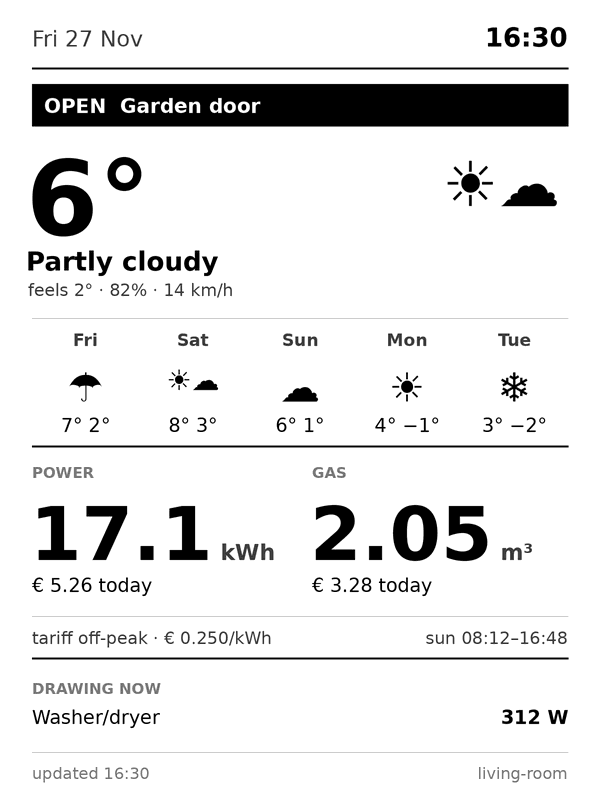

# kindle-dash

A Home Assistant dashboard for a jailbroken e-ink Kindle, rendered server-side as a
single 600×800 PNG. The Kindle holds no credentials, runs no JavaScript and speaks no
TLS: it fetches one image every five minutes and blits it to the framebuffer.



*Rendered with `python3 render.py --demo`: the same frame the device draws.*

## Why this shape

An old Kindle makes a great wall panel: e-ink is readable in daylight, sips power, and
you already own it. What it makes is a terrible web client. A 2011 Kindle 4 ships a
WebKit build from before ES6, will not validate a modern TLS chain, and cannot render a
Lovelace dashboard no matter how you simplify it.

So the split is deliberate:

- **The server does all the work.** `render.py` talks to Home Assistant, composes the
  panel with Pillow, and serves one greyscale PNG. All the layout lives in Python where
  you can test it.
- **The device does one dumb thing.** `curl` a PNG, `eips` it to `/dev/fb0`. No token on
  the device, nothing to parse, nothing to break when Home Assistant changes.
- **Failure degrades to "stale", never "blank".** The server keeps the last good frame
  when Home Assistant is down; the device keeps its last frame when the server is down.

```
Home Assistant ──REST──> render.py ──PNG──> server.py ──HTTP──> Kindle ──eips──> panel
   (states,               (Pillow)          (:8099, 5-min        (jailbroken,
    forecast,                                cache, last-good     framework
    history)                                 frame)               stopped)
```

## What's on the panel

Header with date and time · an inverse **OPEN** bar when a door or window is open ·
current conditions with a weather glyph · five-day forecast · today's power and gas with
cost · active tariff and daylight window · the biggest consumers right now · a footer
with the last update time.

Everything is wired in `config.toml`, including every word on the screen, so a
translation or a different set of sensors needs no code changes.

## Try it without Home Assistant

```sh
python3 -m venv .venv && .venv/bin/pip install Pillow
.venv/bin/python render.py --demo out/demo.png
```

`--demo` uses canned data matching `config.example.toml`, so you get a representative
frame with no token and no network. `tests/smoke.sh` renders it and asserts the output is
a 600×800 8-bit greyscale PNG, which is what `eips` requires.

For a real Home Assistant instance:

```sh
cp config.example.toml config.toml     # then edit entities
export HASS_TOKEN=...                  # HA profile -> Security -> long-lived token
.venv/bin/python server.py             # http://localhost:8099/dash.png
```

## Requirements

| where | what |
|---|---|
| server | Python 3.11+ (uses `tomllib`), `Pillow`, **`fonts-dejavu-core`** |
| server | network access to Home Assistant |
| device | jailbroken Kindle 4 or Touch (firmware 4.0.x–4.1.4) with USBNetwork installed |

A container or VM is plenty: this runs in a Debian 13 LXC with 512 MB of RAM. Without
the DejaVu font the renderer exits with a clear message instead of a PIL traceback. A bare
container has no fonts at all.

## Install

Three steps, detailed in [docs/install.md](docs/install.md):

1. **Jailbreak the Kindle** and install USBNetwork (third-party, not vendored here).
   Jailbreaking is also what stops the screensaver painting over the panel.
2. **Put the files on the device:** `sudo bash tools/copy_to_kindle.sh
   http://server:8099` writes them to the Kindle's FAT partition, sets the server URL,
   and verifies every byte on the way back.
3. **Install on the device:** from a root shell over USBNetwork, `sh /mnt/us/install.sh`.
   It writes `/etc/init.d/dash` and the `/etc/rcS.d/S99dash` boot hook and starts the
   loop. `install.sh remove` undoes it.

On the server, deploy to `/opt/kindle-dash`, then:

```sh
sudo install -m 640 -o root -g kindle-dash /dev/null /etc/kindle-dash.env
printf 'HASS_TOKEN=%s\n' 'your-token' | sudo tee /etc/kindle-dash.env >/dev/null
sudo cp systemd/kindle-dash.service /etc/systemd/system/
sudo systemctl enable --now kindle-dash
```

## Configuration

| section | what it controls |
|---|---|
| `[ha]` | Home Assistant URL, token via env var or dotenv |
| `[server]` | bind address, port, refresh window, PNG path, handoff dir |
| `[display]` | size, rotation, grey levels, number format, timezone, footer name, font dir |
| `[weather]` | weather entity and forecast length |
| `[text]` | every visible word (translations live here) |
| `[energy]` | cumulative kWh/cost counters, gas, tariff state entity, prices |
| `[consumers]` | instantaneous power sensors with display names |
| `[doors]` | door/window binary sensors with display names |

Two gotchas before you debug your own config: sensor keys in `[consumers]` and `[doors]`
**must be quoted** (`"sensor.foo" = "Fridge"`), because TOML reads an unquoted
`sensor.foo` as a nested table; and energy counters are diffed against their value at
local midnight, so they must be *cumulative*, not already-daily sensors.

## HTTP surface

| path | what |
|---|---|
| `/dash.png` | the panel, re-rendered at most once per `refresh_seconds` |
| `/dash.png?force=1` | bypass the cache |
| `/dash.png?h=780` | shorter variant for the stock Kindle browser (its toolbar eats 20–60 px) |
| `/dash.png?invert=1&dx=2&dy=1` | burn-in variants, rendered per request |
| `/` | HTML wrapper with a meta refresh, for a stock device |
| `/health` | `ok` |
| `/files/` | read-only handoff dir (device scripts) |

Nothing is authenticated. Serve it on a trusted LAN only: the PNG is a picture of your
house. The device path is plain HTTP on purpose, because a 2011 TLS stack cannot validate
modern certificates.

## Burn-in

E-ink dislikes identical pixels for months. Three independent measures, all in
`kindle/dash-main.sh`:

- every update is a **full refresh** (`eips -g FILE -f`), not a partial one;
- the layout **drifts** two pixels through four positions, changing once an hour;
- once a day around **03:00** the panel shows an **inverted frame** for two minutes,
  driving the pixels that are normally white.

The wash decision is unit-tested without hardware (`sh tests/wash_due.sh`, 15 cases), and
`tests/glyphs.py` asserts every weather glyph exists in the font, because a missing code point
draws a hollow `.notdef` box that reads as intentional design until you know better.

## Operating it

```sh
journalctl -u kindle-dash -f          # server: one line per request, with client address
tail -f /mnt/us/kindle-dash/dash.log  # device: one line per cycle, rotated at 64 KB
```

On the device, `/etc/init.d/dash {start|stop|status|restart}`, or the KUAL menu entry in
`kindle/extension/`. The loop **self-updates** `dash-main.sh` from the server's `/files/`
on every start, syntax-checked, falling back to the local copy, so a fix ships with a
reboot instead of another USB trip.

Two more documents worth reading before you debug anything:
[docs/architecture.md](docs/architecture.md) for the loop in detail, and
[docs/pitfalls.md](docs/pitfalls.md) for the device quirks that cost real time
(`eips` returning success while drawing nothing, the reader UI being supervised, cron
resurrecting the framework, the jailbreak installing into the wrong filesystem).

## Limits

- **No suspend.** `echo mem` with the reader framework stopped reboots this firmware, so
  the device sleeps in software and stays awake with Wi-Fi up: fine on USB power, days
  rather than weeks on battery. Doing it properly means letting `powerd` own the sleep
  cycle with the framework alive.
- **No input path.** With the framework stopped the device has no UI, so rebooting means
  the power switch (hold ~20 s) or a shell over USBNetwork.
- **Kindle 4 / Touch only.** The device script targets the shell, `eips` and init this
  firmware has; Paperwhite and later differ in all three.

## Licence

MIT. See [LICENSE](LICENSE).
